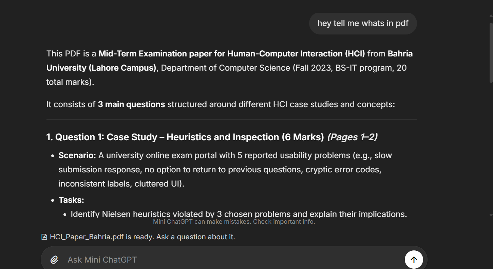
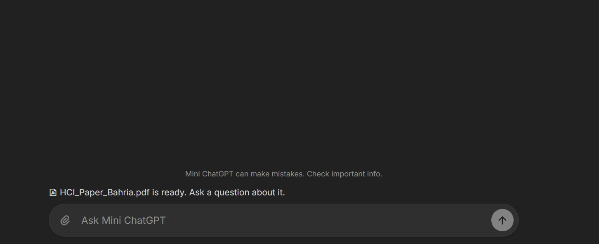
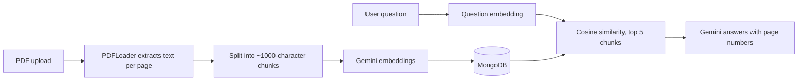

# Mini ChatGPT

A full-stack AI chat app built with the MERN stack. You can chat with an AI assistant that searches the web for current information, and upload a PDF to ask questions about it. Answers about a PDF cite the page they came from.

> Personal learning project. It is not affiliated with OpenAI or ChatGPT.

## Screenshots

**Asking about an uploaded PDF**



**After a PDF upload**



## Features

**AI chat**
- Conversations with history, saved per user
- Web search through Tavily when a question needs current information, such as news or prices
- Short chat titles generated automatically from the first message
- Markdown answers, including tables and code blocks

**Chat with your PDF (RAG)**
- Upload a PDF of up to 10 MB into a new or existing chat
- The text is split into chunks and turned into embeddings, which are stored in MongoDB
- Each question retrieves the 5 most relevant chunks, and the answer cites their page numbers
- Scanned PDFs without readable text are rejected with a clear message

**Accounts and security**
- Sign up with email verification, plus a resend option
- Forgot password: reset links expire in 15 minutes and work once
- JWT stored in an httpOnly cookie, with logout blacklisting in Redis
- Changing the password signs out every older session
- Accounts that stay unverified are deleted after 2 days, so the email address frees up again
- Rate limits on login, verification emails and password reset
- Server-side validation of every input

## Tech stack

| Area | Tools |
|---|---|
| Frontend | React 19, Vite, Redux Toolkit, React Router 7, Tailwind CSS 4, react-markdown |
| Backend | Node.js, Express 5, Mongoose 8, express-validator, express-rate-limit, Multer |
| Data | MongoDB Atlas, Redis |
| AI | LangChain, Google Gemini (answers and embeddings), Groq (chat titles), Tavily (web search) |
| Services | ImageKit (PDF storage), Nodemailer with Gmail (emails) |

## How PDF chat works



- **Chunking:** `RecursiveCharacterTextSplitter`, 1000 characters with 200 characters of overlap
- **Embeddings:** `gemini-embedding-001`, 3072 dimensions
- **Retrieval:** cosine similarity on the server, using only chunks from finished uploads
- **Clean up:** if an upload fails partway, its file, chunks and new chat are removed. Deleting a chat also deletes its PDFs from ImageKit.

## Reliability

- AI answers time out after 60 seconds, and the agent can take at most 10 steps
- Web search times out after 15 seconds and sends only the title, URL and content to the model
- If title generation fails, the chat is still created as "New Chat"
- If Redis is down, protected routes return `503` quickly instead of hanging
- MongoDB indexes cover every main query

## Project structure

```
Mini ChatGpt/
├── backend/
│   ├── server.js
│   └── src/
│       ├── config/        # MongoDB and Redis connections
│       ├── controllers/   # auth, chat and document handlers
│       ├── middlewares/   # auth, errors, rate limits, uploads
│       ├── models/        # User, Chat, Message, Document, DocumentChunk
│       ├── routes/        # /api/auth and /api/chats
│       ├── services/      # AI, embeddings, retrieval, PDF, email, ImageKit, search
│       └── validators/
└── frontend/
    └── src/
        ├── app/           # router and Redux store
        └── features/
            ├── auth/      # login, sign up, verification, password reset
            └── chat/      # chat layout, sidebar, composer, PDF upload
```

## Getting started

### Requirements
- Node.js 20 or newer
- A MongoDB database, such as a free MongoDB Atlas cluster
- A Redis database, such as a free Redis Cloud database
- API keys for Google Gemini, Groq, Tavily and ImageKit
- A Gmail account with an App Password for sending emails

### 1. Backend

```bash
cd backend
npm install --legacy-peer-deps
```

`--legacy-peer-deps` is needed because `@langchain/community` declares an optional peer dependency that conflicts with `dotenv`.

Create `backend/.env`:

| Variable | Description |
|---|---|
| `PORT` | Backend port. Use `3000`, because the frontend calls `http://localhost:3000` |
| `MONGO_URI` | MongoDB connection string |
| `REDIS_URL` | Redis connection string |
| `JWT_SECRET` | A long random string used to sign tokens |
| `GOOGLE_API_KEY` | Google Gemini API key |
| `GROQ_API_KEY` | Groq API key |
| `TVLY_API_KEY` | Tavily API key |
| `IMG_KIT_KEY` | ImageKit private key |
| `GOOGLE_USER` | Gmail address that sends the emails |
| `GOOGLE_APP_PASSWORD` | Gmail App Password for that address |

Start the server:

```bash
npm run dev
```

### 2. Frontend

```bash
cd frontend
npm install
npm run dev
```

Open http://localhost:5173.

## API overview

**Auth (`/api/auth`)**

| Method | Route | Purpose |
|---|---|---|
| POST | `/register` | Create an account and send a verification email |
| GET | `/verify-email/:token` | Verify the email address |
| POST | `/resend-verification` | Send a new verification link |
| POST | `/login` | Log in and set the auth cookie |
| GET | `/me` | Get the current user |
| POST | `/logout` | Log out and blacklist the token |
| POST | `/forgot-password` | Send a password reset link |
| POST | `/reset-password` | Set a new password |

**Chats (`/api/chats`, login required)**

| Method | Route | Purpose |
|---|---|---|
| POST | `/message` | Send a message, creating a chat if needed |
| GET | `/` | List the user's chats |
| GET | `/:chatId/messages` | Get the messages of a chat |
| POST | `/documents` | Upload a PDF as `multipart/form-data` (`file`, optional `chat`) |
| DELETE | `/:chatId` | Delete a chat with its messages and PDFs |

## Known limitations

- **Large PDFs:** retrieval loads all embeddings of a chat into memory. Very large documents would need MongoDB Atlas Vector Search instead.
- **Deployment:** the frontend and backend URLs are hardcoded to `localhost`, and the auth cookie is not yet set up for HTTPS.
- **Rate limits:** chat messages, PDF uploads and sign-ups are not rate limited yet.
- **Responses:** answers are not streamed, and the user's message appears only after the AI replies.
- **Mobile:** the sidebar is hidden on small screens.
- **Tests:** there are no automated tests yet.

## Roadmap

- [ ] Environment-based URLs and secure cookies for deployment
- [ ] Rate limits on chat, upload and sign-up
- [ ] Show the user's message immediately, with a retry on failure
- [ ] Streaming responses
- [ ] MongoDB Atlas Vector Search for large PDFs
- [ ] Mobile sidebar
- [ ] Automated tests
